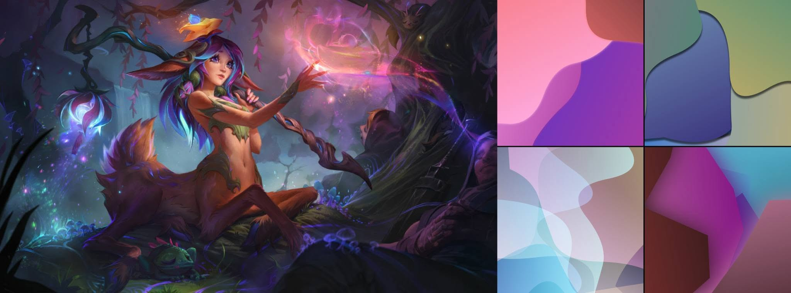
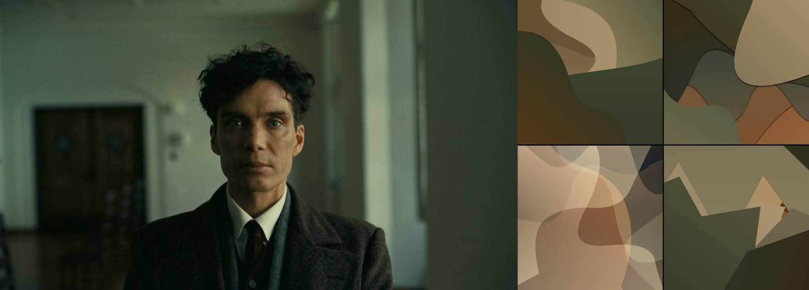
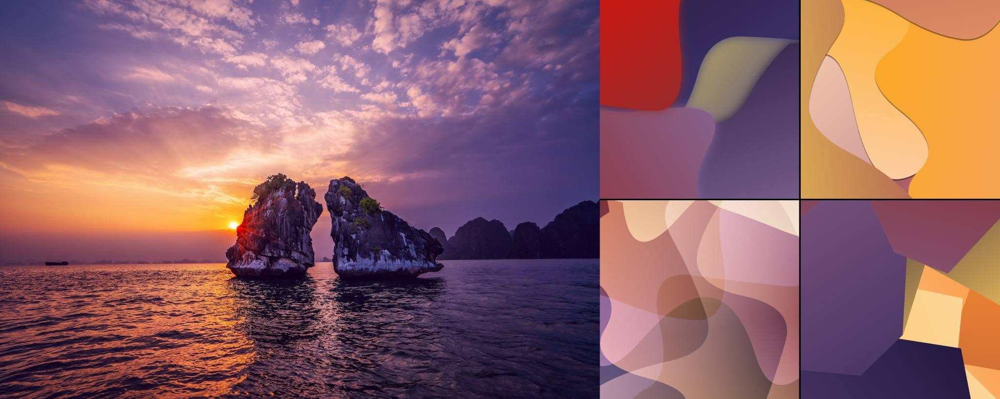

# Fluid Mesh Studio HD

A generative art studio, Color DNA analyzer and colour-to-sound tool, built with vanilla JavaScript and HTML5 Canvas. No build step, no server, no third-party libraries. **Your images never leave your device.**


---

## Live Demo

Experience the tool directly in your browser:

**👉 [Click here to Launch](https://hieu-bit346.github.io/fluid-mesh-studio/)**

---

## Overview

**Fluid Mesh Studio HD** is a web-based tool that takes your uploaded images, extracts their main colour palettes, and transforms them into various styles of generative art. You can choose from a wide range of visual modes, including fluid mesh waves, layered paper-cuts, glowing aurora fields, angular polygons, crystal facets, and liquid-chroma metal. 

However, it is more than just an image generator. The application also provides a complete workspace featuring a Color Lab for detailed colour analysis, an info-card studio for creating custom layouts, and tools for palette exporting and animation recording. One of its most unique features is the Soundscape engine, which automatically generates background music based on the specific colours and mood of your current artwork.

This project is built and optimized with the support of the AI agent Gemini (Google) and Claude (Anthropic).

---

## Features

#### Generative Art: 6 styles, 19 sub-modes

| Style | Sub-modes |
| :--- | :--- |
| **Mesh Glow** | Fluid |
| **Paper Cut** | Waves, Canyon, Cutout |
| **Aurora** | Prism, Glass, Neon |
| **Polygon** | Flat, Faceted, Constellation, Isometric, Shatter |
| **Crystal** | Harmonic, Chaotic, Geode, Stained |
| **Liquid Chroma** | Mercury, Iridescent, Molten |

*Plus 10 creative presets, Randomize / Remix, a variation gallery (6 / 9 / 12), Harmony Lab (complementary, analogous, triad, split, monochrome) and undo / redo.*

### Color Lab
- Copy any colour as HEX, RGB, RGBA, HEXA, HSL or HSV.
- EyeDropper (with a fallback for browsers without it).
- WCAG contrast checks against the artwork background.
- Manual colour editing and colour collections.
- Export selected colours as `.GPL` (GIMP / Photoshop), CSS variables, JSON or TXT.

### Soundscape: Colour becomes music
The palette decides the music, and the same colours always give the same piece.
- **Warm colours** → Major Pentatonic, marimba-like tone, faster tempo.
- **Cool colours** → Minor Pentatonic / Dorian, soft kalimba-like tone, slower tempo with more rests.
- **Brightness (V)** → Register and energy; **Saturation (S)** → Filter and harmonic richness.
- Dominant colours weigh more than minor ones.
- Each of the 19 sub-modes keeps its own sound identity.
- Export the soundscape as a mastered `.WAV` (what you hear live is what you export).

### Export
- PNG at any ratio (1:1, 4:5, 3:2, 16:9, 9:16 or custom) and size from 500 up to 4096 px.
- Transparent-background PNG, with a warning if the result is not really transparent.
- 3840 px export is rendered in a background worker, so the page stays responsive (falls back to the main thread where workers are unavailable).
- Animation preview and WebM video recording (3 – 12 s).
- Save / open projects as versioned `.json`.

### Studio Tools
- **Manual Crop Tool:** Circular crop with live zoom and position tracking.
- **Info Card Studio:** Dual-frame card (Avatar & Cover layout) exported to high-res PNG, with its own English / Vietnamese switch.
- **Comparison & Composite Board:** Save outputs, compare colour metrics side by side (2 – 4) and build composite sheets (up to 8).
- **Presentation mode** (`P`).
- **English / Vietnamese interface**, remembered between visits.

---

## Shortcuts

| Key | Action |
| :--- | :--- |
| `G` | Generate |
| `E` | Download PNG |
| `R` / `Shift+R` | Remix / Randomize all |
| `P` | Presentation |
| `V` | Variations |
| `1`, `2`, `3` | Studio / Color Lab / Board |
| `S` | Save to Board |
| `?` | Shortcut list |
| `Ctrl+Z` / `Ctrl+Shift+Z` | Undo / Redo |
| `Esc` | Close dialog or drawer |

---

## Showcase & Visual Samples

Here are some demonstration outputs and source samples processed using **Fluid Mesh Studio HD**:

<p align="center">
  
</p>
<p align="center">
  
</p>
<p align="center">
  
</p>

### Image Credits & Sources
Special thanks to the original creators and photographers for the demo assets used in this project:

1. **Digital Concept Art:** [ArtStation Artwork](#)
2. **Cinematic Visual Asset:** [World of Reel Article](#)
3. **Landscape Photography (Ha Long Bay):** [Báo Lao Động Media CDN](#)

> *Disclaimer: All sample images belong to their respective copyright holders and are used solely for non-commercial demonstration and open-source portfolio showcasing purposes.*

---

## Project Structure

```text
fluid-mesh-studio/
├── index.html                       # Markup and dialogs (plus a tiny start-up guard)
├── css/
│   └── style.css                    # Styles, theme tokens, responsive layout
├── js/
│   ├── dict.js, i18n.js             # English / Vietnamese dictionary and helpers
│   ├── color-math.js, color.js      # Colour maths, palette extraction, Color DNA metrics
│   ├── engine.js                    # Artwork settings -> render parameters
│   ├── renderer.js                  # Canvas rendering of all 6 styles
│   ├── png-worker.js                # Background PNG export
│   ├── presets.js, state.js, ui-kit.js, source.js, crop-ui.js
│   ├── exports.js, storage.js       # PNG / WebM / project / palette export, Board
│   ├── sound-music.js               # Colour -> scale, tempo, rests (pure logic)
│   ├── sound-effects.js, sound-engines.js, sound-export.js
│   ├── soundscape.js, sound-ui.js   # Live player and sound controls
│   └── colorlab.js, cards.js, app.js
└── README.md
